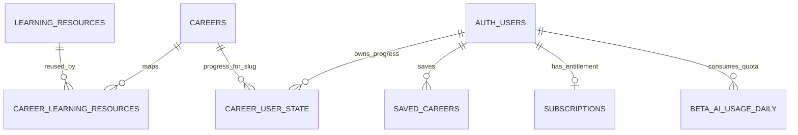

# Dynamic Career Intelligence Engine — Existing Architecture Audit

**Repository:** `rythm2237/AI-positions-roadmap`  
**Audited revision:** `95b9e9ea72cd0b990d569fc659f86443aae302f0`  
**Production project:** Vercel `ai-positions-roadmap`; custom domains include `airolepath.com` and `www.airolepath.com`.  
**Database:** Supabase project `ai roadmap` (`dqpdyschjpbdhhotmojs`, active/healthy).  
**Audit date:** 2026-10-26.

## Existing generation and page flow

- `/api/admin/careers/generate` is an authenticated admin-only, synchronous generator. It generates a Career Blueprint, assembles it into `CareerWorkspaceData`, validates it, and saves a `careers` row as draft/review content. There is no subscriber-facing career discovery queue.
- `/api/admin/careers/[id]/resources/generate` is a separate admin curation operation. The generator contract forbids URLs during Blueprint generation. Resource curation happens after the career structure exists.
- `/careers/[slug]` uses the shared `CareerWorkspace` for published database careers and built-in data careers. Published DB content passes `validateCareerWorkspaceData` before rendering.
- `CareerWorkspaceData.journeyStages` is the shared source for Roadmap and Learning stage order and stable progress IDs. User progress is stored separately in `career_user_state` keyed by user and career slug.
- Authentication is Supabase Auth. Subscription state is represented by `subscriptions` and Stripe-synchronized `role_path_plan` app metadata. Current application entitlements are `free` and `pro`; the database enum additionally includes `enterprise`. Essential/Career Pro product tiers and career-generation credits are not currently configured.

## Learning resource source of truth

The accepted design is documented in `docs/architecture/CAREER_RESOURCE_ARCHITECTURE.md` and ADR-0001:

1. Career Blueprint and milestone requirement contracts are authored without external URLs.
2. A modular Central Resource Registry owns canonical resources and verification metadata.
3. A mapping connects resource IDs to career requirements and milestones.
4. The shared Learning UI renders resolved content.

The codebase has two representations that must be reconciled carefully:

- Source catalog: `content/references/reference-catalog.json`, resolved through `src/lib/references/referenceResolver.ts` and career data modules.
- Database registry: `public.learning_resources`, unique on `(canonical_url, mode)`, with verification, review, lifecycle, and provider metadata. `public.career_learning_resources` is the normalized career-to-resource mapping, keyed by `(career_id, requirement_id, mode)` and references the canonical `learning_resources.id`.
- `admin_sync_career_learning_resources` upserts registry metadata by canonical URL/mode and rebuilds one career's mappings transactionally. Existing IDs are retained for the same canonical identity. This is already the required shared-resource, multiple-career relationship; no parallel registry is needed.
- Current managed career pages still read resource metadata from `careers.workspace_data` and do not resolve mapping rows back through `learning_resources` at render time. Consequently, the DB registry is not yet authoritative for all displayed fields after an initial sync. This is an integration gap for propagation of shared updates.

## Actual relationship diagram

`CAREER_LEARNING_RESOURCES` stores `career_id`, `requirement_id`, `milestone_id`, `mode`, `resource_id`, and approval state. `CAREERS.workspace_data` contains the rendering snapshot and stable stage IDs. User progress is not stored in that shared JSON document.

## Safe extension plan

- Keep `careers`, `learning_resources`, and `career_learning_resources` as canonical shared records.
- Resolve eligible mapped resource metadata from the registry at managed career page load, preserving the career's contextual milestone relationship and stable progress IDs.
- Add a server-side, feature-flagged discovery endpoint and an asynchronous idempotent generation queue. New careers remain in review; no AI-generated content is automatically published.
- Check exact canonical titles and explicit aliases before creating work. Keep adjacent roles distinct and return an ambiguity result for close candidates instead of merging them silently.
- Gate generation on current server-side `pro` entitlement and a configurable credit limit; viewing an existing published career does not debit generation usage. Leave prices and Stripe products unchanged.
- Store only shared role/query content in generation records. Never put CV, profile, assessment, or personal roadmap information into the shared career knowledge base.
- Reuse only verified eligible catalog rows. If a milestone has no strong match, preserve a resource gap for Admin curation; do not fabricate a link or certificate.
- Use additive migrations and preserve `career_user_state` as the progress source.

## Environment and deployment evidence

The active GitHub repository and Vercel project are linked. Vercel currently identifies a ready deployment on the `production` target at the audited revision; the project API reports `live: false`, so a public production rollout is not assumed. Supabase reports the `ai roadmap` project as active/healthy. No production schema changes were made during this audit.

The current checkout is the audited main revision. Implementation is isolated on `feat/dynamic-career-intelligence`; changes are not deployed to production by this task.
